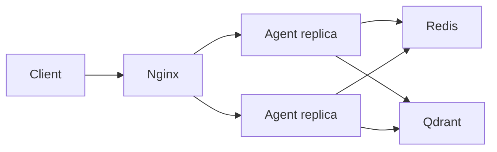

# Day 14 Lab — Mission Answers

> Bài làm có AI hỗ trợ (khai báo đầy đủ ở mục AI log cuối bài). Mọi số liệu, output lệnh, kết quả `PASS 12/12`, URL Render công khai, file JSON/CSV và ảnh chụp trong repo đều thu được từ quá trình chạy thực tế.

## Part 1: Localhost vs Production

### Exercise 1.1: Anti-patterns trong `01-localhost-vs-production/develop/app.py`

1. Hardcode credential trực tiếp trong mã nguồn (`develop/app.py` dòng 17–18: `OPENAI_API_KEY`, `DATABASE_URL`); ai đọc mã nguồn hoặc lịch sử Git đều lấy được bí mật. Bản `production/app.py` sửa bằng cách đọc cấu hình qua `config.settings` từ biến môi trường (dòng 24).
2. Bật `DEBUG = True` và cấu hình cứng (`develop/app.py` dòng 21–22) thay vì quản lý theo môi trường.
3. Dùng `print()` in câu hỏi, câu trả lời và cả `OPENAI_API_KEY` ra stdout (`develop/app.py` dòng 33–38), gây lộ bí mật và log không có cấu trúc. Bản `production/app.py` chuyển sang JSON logging và không ghi secret (dòng 28–32, 111–122).
4. Thiếu `/health` và `/ready`, khiến nền tảng không phân biệt được process chết với ứng dụng chưa sẵn sàng. Bản `production/app.py` bổ sung đầy đủ cả hai endpoint (dòng 135–161).
5. Chỉ bind `host="localhost"`, cố định `port=8000` và bật `reload=True` (`develop/app.py` dòng 49–53), không chạy được trong container/cloud. Bản `production/app.py` dùng `settings.host` (`0.0.0.0`), `settings.port` từ `PORT` và chỉ bật `reload` khi `settings.debug=True` (dòng 194–199).
6. Không có lifecycle cleanup / xử lý `SIGTERM` để hoàn tất request đang chạy khi tắt. Bản `production/app.py` bổ sung `lifespan` (dòng 40–67) và handler `SIGTERM` (dòng 180–189).

### Exercise 1.2: Chạy và kiểm thử bản `develop`

Vì cổng 8000 trên máy đang có dịch vụ khác chiếm dụng, chạy bản `01-localhost-vs-production/develop/app.py` trên cổng trống (18001) và gọi `GET /` cùng `POST /ask?question=Hello` (lưu ý bản develop nhận `question` qua query string):

```http
HTTP/1.1 200 OK
content-type: application/json

{"message":"Hello! Agent is running on my machine :)"}
```

```http
HTTP/1.1 200 OK
content-type: application/json

{"answer":"Agent đang hoạt động tốt! (mock response) Hỏi thêm câu hỏi đi nhé."}
```

### Exercise 1.3: So sánh `develop` và `production`

| Tiêu chí | Develop (cơ bản) | Production (nâng cao) | Tại sao quan trọng? |
|---|---|---|---|
| Cấu hình & Secret | Hardcode trong source (`develop/app.py` dòng 17–22) | `config.py` đọc biến môi trường | Cùng một image chạy được ở dev/staging/prod; không commit secret vào Git. |
| Bind & Port | `localhost:8000` cố định | `0.0.0.0` và `PORT` từ env | Container/cloud cần lắng nghe mọi interface và dùng port do platform cấp. |
| Health check | Không có | `/health` (liveness) và `/ready` (readiness) | Liveness giúp platform restart khi crash; readiness kiểm soát việc route traffic. |
| Logging | `print()`, in cả API key ra stdout | Structured JSON logging, không log secret | Dễ lọc/tìm trên log aggregator và tránh rò rỉ bí mật. |
| Shutdown | Tắt đột ngột, không cleanup | FastAPI `lifespan` + xử lý `SIGTERM` | Hoàn tất request đang xử lý trước khi thoát, không cắt ngang người dùng khi deploy. |
| Auto-reload | Luôn bật (`reload=True`) | Chỉ bật khi `DEBUG=true` | `reload` gây tốn tài nguyên và không ổn định trên production. |

## Part 2: Docker

### Exercise 2.1: Dockerfile cơ bản

1. Base image: `python:3.11`.
2. Working directory: `/app`.
3. Copy `requirements.txt` và cài dependencies trước khi copy source để Docker tái sử dụng dependency layer khi chỉ đổi code.
4. `CMD` cung cấp lệnh mặc định có thể thay khi chạy container; `ENTRYPOINT` cố định executable chính, còn `CMD` thường cấp default arguments cho executable đó.

### Exercise 2.2–2.3: Build, chạy container và so sánh kích thước image

1. **Chạy container `my-agent:develop` và gọi `POST /ask?question=Hello` (Exercise 2.2):**

```http
HTTP/1.1 200 OK
server: uvicorn
content-type: application/json

{"answer":"Đây là câu trả lời từ AI agent (mock). Trong production, đây sẽ là response từ OpenAI/Anthropic."}
```

2. **Đo kích thước image bằng `docker images my-agent` (Exercise 2.3):**

```text
REPOSITORY          TAG         IMAGE ID      CREATED             SIZE
localhost/my-agent  advanced    a4a866132dad  About a minute ago  168 MB
localhost/my-agent  develop     8f307d3fff09  About a minute ago  1.18 GB
```

- **Develop (`my-agent:develop`):** 1.18 GB (~1.180 MB)
- **Production (`my-agent:advanced`):** 168 MB
- **Chênh lệch:** giảm **~1.012 MB (~85,8%)**

Dockerfile bản production tách thành **stage builder** (cài compiler `gcc`, `libpq-dev` và compile/install dependencies vào `/root/.local`) và **stage runtime** dùng `python:3.11-slim`, chỉ copy packages đã cài và mã nguồn cần thiết sang, chạy bằng user non-root `appuser` và có `HEALTHCHECK`. Nhờ loại bỏ toàn bộ build tools và dùng base `slim`, image nhỏ hơn ~85,8%, pull/deploy nhanh hơn và giảm bề mặt tấn công.

### Exercise 2.4: Kiến trúc Docker Compose và kết quả test qua Nginx



Compose khởi động `agent`, `redis`, `qdrant` và `nginx` trên mạng nội bộ `internal`. Nginx làm reverse proxy/load balancer nhận traffic bên ngoài và chuyển tiếp vào `agent:8000`; Redis lưu cache/session/rate-limit state; Qdrant phục vụ vector retrieval.

Kết quả kiểm thử thực tế đi qua Nginx (`GET /health` và `POST /ask`):

```http
HTTP/1.1 200 OK
Server: nginx
Content-Type: application/json
X-Frame-Options: DENY
X-Content-Type-Options: nosniff
X-XSS-Protection: 1; mode=block

{"status":"ok","uptime_seconds":0.5,"version":"2.0.0","timestamp":"2026-11-25T11:00:36.464331"}
```

```http
HTTP/1.1 200 OK
Server: nginx
Content-Type: application/json
X-Frame-Options: DENY
X-Content-Type-Options: nosniff

{"answer":"Container là cách đóng gói app để chạy ở mọi nơi. Build once, run anywhere!"}
```

## Part 3: Cloud Deployment

### Exercise 3.2: Triển khai agent Part 6 lên Render (nền tảng chính)

- **URL công khai:** https://day14-production-agent-u3t1.onrender.com
- **Kiến trúc trên Render (region `singapore`, gói `free`):**
  - Web Service `day14-production-agent` chạy Docker từ `06-lab-complete/Dockerfile`, health check `/health`, tự đọc `PORT` do Render cấp.
  - Dịch vụ Redis `day14-agent-redis` (Render Key Value, gói `free`) cung cấp `REDIS_URL` nội bộ cho `/ready`, rate limiting và cost guard.
  - Khóa `AGENT_API_KEY` cùng các biến môi trường (`ENVIRONMENT=production`, `RATE_LIMIT_PER_MINUTE=10`, `DAILY_BUDGET_USD=1.0`, `REDIS_URL`) được đặt trên Render, không lưu trong mã nguồn.
- **Kết quả chạy 4 lệnh tự kiểm CP6 trên URL công khai:**

```text
GET  /health              -> 200  {"status":"ok"}
GET  /ready               -> 200  {"ready":true}
POST /ask (không có key)  -> 401  {"detail":"Invalid or missing X-API-Key"}
POST /ask (có X-API-Key)  -> 200  {"question":"Hello","answer":"Agent đang hoạt động tốt! (mock response) Hỏi thêm câu hỏi đi nhé.","usage":{"input_tokens":2,"output_tokens":17,"cost_usd":1.05e-05}}
```

- **Ảnh chụp màn hình:** xem chi tiết trong [DEPLOYMENT.md](DEPLOYMENT.md) (`screenshots/dashboard.png`, `screenshots/running.png`, `screenshots/test.png`).

**So sánh `railway.toml` với `render.yaml`:** `06-lab-complete/railway.toml` cấu hình builder `DOCKERFILE`, `healthcheckPath = "/health"` và restart policy cho một service đơn lẻ (dịch vụ Redis trên Railway tạo tách biệt trên dashboard hoặc qua CLI). Ngược lại, `06-lab-complete/render.yaml` theo chuẩn Blueprint mô tả đồng thời nhiều tài nguyên trong cùng một file: cả Web Service Docker (`plan: free`, `rootDir: ./06-lab-complete`, `healthCheckPath: /health`) lẫn dịch vụ Redis Key Value (`type: keyvalue`, `plan: free`), đồng thời khai báo nối tự động `REDIS_URL` qua `fromService` và sinh secret `AGENT_API_KEY` qua `generateValue: true` mà không ghi khóa vào Git.

Tham khảo định dạng chính thức: [Render Blueprint YAML](https://render.com/docs/blueprint-spec) và [Railway config-as-code](https://docs.railway.com/config-as-code/reference).

**Exercise 3.3 — Cloud Run pipeline:** Cloud Build chạy `pytest`, sau đó build Docker image có tag commit SHA và `latest`. Khi test thành công, pipeline push image lên Container Registry rồi deploy tag theo commit lên Cloud Run tại `asia-southeast1`. `service.yaml` khai báo ingress, concurrency/autoscaling, tài nguyên, environment variables lấy từ Secret Manager và health probes. Không cần deploy để mô tả pipeline.

## Part 4: API Security

### Exercise 4.1: Xác thực API Key (`04-api-gateway/develop`)

Khởi chạy với `AGENT_API_KEY=secret-key-123` và kiểm thử bằng `curl -i`:

1. **Không gửi `X-API-Key` → HTTP 401:**

```http
HTTP/1.1 401 Unauthorized
content-type: application/json

{"detail":"Missing API key. Include header: X-API-Key: <your-key>"}
```

2. **Có `X-API-Key: secret-key-123` → HTTP 200:**

```http
HTTP/1.1 200 OK
content-type: application/json

{"question":"Hello","answer":"Tôi là AI agent được deploy lên cloud. Câu hỏi của bạn đã được nhận."}
```

### Exercise 4.2–4.3: Kiểm tra JWT và Rate Limit (`04-api-gateway/production`)

Trong bản nâng cao, `POST /auth/token` xác thực user (`student` / `demo123`) rồi ký JWT HS256. `verify_token` kiểm tra chữ ký và thời hạn token, sau đó trả username/role cho route. Thiếu token trả 401; token sai/hết hạn trả 403/401. Khi xoay vòng (rotate) khóa bí mật ký token, token cũ không còn hợp lệ và client phải đăng nhập lại.

Rate limiter dùng **sliding window** theo user: tài khoản thường (`student`) giới hạn **10 request / 60 giây**, còn `admin` là 100 request / 60 giây. Khi vượt quota, API trả `429 Too Many Requests` kèm header `Retry-After`.

Kết quả chạy `curl -i` thực tế (token JWT đã được che thành `<REDACTED_JWT>`):

1. **Không gửi `Authorization` header → HTTP 401:**

```http
HTTP/1.1 401 Unauthorized
www-authenticate: Bearer
content-type: application/json
x-content-type-options: nosniff
x-frame-options: DENY

{"detail":"Authentication required. Include: Authorization: Bearer <token>"}
```

2. **Có `Authorization: Bearer <REDACTED_JWT>` (request #1) → HTTP 200:**

```http
HTTP/1.1 200 OK
content-type: application/json
x-content-type-options: nosniff
x-frame-options: DENY

{"question":"What is Docker?","answer":"Container là cách đóng gói app để chạy ở mọi nơi. Build once, run anywhere!","usage":{"requests_remaining":9,"budget_remaining_usd":1.9e-05}}
```

3. **Vòng lặp gửi liên tiếp request #2 → #12 (vượt ngưỡng 10 req/phút từ request #11 → HTTP 429):**

```text
Request #2  -> HTTP 200
Request #3  -> HTTP 200
Request #4  -> HTTP 200
Request #5  -> HTTP 200
Request #6  -> HTTP 200
Request #7  -> HTTP 200
Request #8  -> HTTP 200
Request #9  -> HTTP 200
Request #10 -> HTTP 200
Request #11 -> HTTP 429
Request #12 -> HTTP 429
```

Chi tiết `curl -i` của request #11:

```http
HTTP/1.1 429 Too Many Requests
x-ratelimit-limit: 10
x-ratelimit-remaining: 0
x-ratelimit-reset: 1795602268
retry-after: 59
content-type: application/json
x-content-type-options: nosniff
x-frame-options: DENY

{"detail":{"error":"Rate limit exceeded","limit":10,"window_seconds":60,"retry_after_seconds":59}}
```

**Vì sao cần cả Rate Limit và Cost Guard:** Rate limit kiểm soát *tốc độ gọi* (số request/phút) để chống spam/DDoS, còn Cost Guard kiểm soát *chi phí tiền thật* (USD theo lượng token input/output) để tránh hóa đơn LLM tăng vọt ngay cả khi số request nằm dưới ngưỡng rate limit.

### Exercise 4.4: Cost guard

Cost guard ước lượng input/output tokens, nhân với giá tương ứng, cộng usage theo user và theo tổng dịch vụ, rồi từ chối request khi budget ngày vượt ngưỡng. Bản demo Part 4 giữ state trong RAM, phù hợp để minh hoạ nhưng không chia sẻ được giữa nhiều worker/restart. Bản Part 6 đã lưu rate-limit và tổng chi phí theo ngày UTC vào Redis; giá token và ngân sách lấy từ cấu hình.

## Part 5: Scaling & Reliability

`/health` là liveness: trả 200 khi process còn chạy. `/ready` là readiness: kiểm tra dependency như Redis và trả 503 khi instance chưa nên nhận traffic. Graceful shutdown để server ngừng nhận request mới, hoàn tất request đang xử lý và đóng tài nguyên.

Conversation history không nên nằm trong dictionary trong RAM vì mỗi replica có memory riêng. Lưu history trong Redis giúp request kế tiếp đọc được dữ liệu dù load balancer gửi sang replica khác. Nginx phân phối request tới agent replicas; khi một replica lỗi, health-aware routing có thể chuyển traffic sang replica còn khoẻ.

### Exercise 5.4–5.5: Chạy stack 3 instance và kiểm thử stateless (`test_stateless.py`)

Khởi chạy stack `05-scaling-reliability/production/` với 3 replica (`docker compose -p k5-day14-scaling up -d --build --scale agent=3`) và chạy `python test_stateless.py`:

```text
============================================================
Stateless Scaling Demo
============================================================

Session ID: b734ada8-c821-4418-9b5a-95c72f456ce0

Request 1: [instance-0c80eb]
  Q: What is Docker?
  A: Container là cách đóng gói app để chạy ở mọi nơi. Build once, run anywhere!...

Request 2: [instance-abfea8]
  Q: Why do we need containers?
  A: Agent đang hoạt động tốt! (mock response) Hỏi thêm câu hỏi đi nhé....

Request 3: [instance-5f89ad]
  Q: What is Kubernetes?
  A: Agent đang hoạt động tốt! (mock response) Hỏi thêm câu hỏi đi nhé....

Request 4: [instance-0c80eb]
  Q: How does load balancing work?
  A: Tôi là AI agent được deploy lên cloud. Câu hỏi của bạn đã được nhận....

Request 5: [instance-abfea8]
  Q: What is Redis used for?
  A: Tôi là AI agent được deploy lên cloud. Câu hỏi của bạn đã được nhận....

------------------------------------------------------------
Total requests: 5
Instances used: {'instance-abfea8', 'instance-0c80eb', 'instance-5f89ad'}
✅ All requests served despite different instances!

--- Conversation History ---
Total messages: 10
  [user]: What is Docker?...
  [assistant]: Container là cách đóng gói app để chạy ở mọi nơi. Build once...
  [user]: Why do we need containers?...
  [assistant]: Agent đang hoạt động tốt! (mock response) Hỏi thêm câu hỏi đ...
  [user]: What is Kubernetes?...
  [assistant]: Agent đang hoạt động tốt! (mock response) Hỏi thêm câu hỏi đ...
  [user]: How does load balancing work?...
  [assistant]: Tôi là AI agent được deploy lên cloud. Câu hỏi của bạn đã đư...
  [user]: What is Redis used for?...
  [assistant]: Tôi là AI agent được deploy lên cloud. Câu hỏi của bạn đã đư...

✅ Session history preserved across all instances via Redis!
```

**Giải thích kết quả:** 5 request thuộc cùng một `session_id` (`b734ada8-c821-4418-9b5a-95c72f456ce0`) được Nginx phân phối đều sang cả 3 container (`instance-0c80eb`, `instance-abfea8`, `instance-5f89ad`), nhưng khi truy vấn `/chat/{session_id}/history` vẫn đọc đủ toàn bộ 10 tin nhắn (5 câu hỏi + 5 câu trả lời) vì trạng thái hội thoại được lưu tập trung trong Redis thay vì RAM cục bộ của từng instance.

## Part 6: Final Project

Đã hoàn thiện toàn bộ bản khung trong `06-lab-complete/`: đọc cấu hình từ biến môi trường (`config.py`), xác thực `X-API-Key` trả 401 (`auth.py`), rate limiter sliding-window trong Redis trả 429 kèm `Retry-After` (`rate_limiter.py`), cost guard lưu chi phí theo ngày UTC trong Redis trả 402 (`cost_guard.py`), `/health` (200 ngay cả khi mất Redis) và `/ready` (503 khi mất Redis), structured JSON logs, FastAPI lifespan graceful shutdown, multi-stage Dockerfile non-root (< 500 MB: **166 MB**), Compose `agent + redis`, `.dockerignore`, `.env.example`, `railway.toml` và `render.yaml`.

Chạy kiểm tra đầy đủ (có container runtime + Redis + URL public): `python check_production_ready.py --public-url https://day14-production-agent-u3t1.onrender.com` đạt **`PASS 12/12` (44/44 checks passed)** — image build thành công 166 MB, state rate limit giữ nguyên sau restart agent nhờ Redis, `docker stop` thoát sạch với `exit code 0` trong `0.5s`, và URL công khai trả `200`.

Phần **Checklist Deliverable** từ output thực tế:

```text
  📋 Checklist Deliverable
     ✅ Dockerfile (multi-stage, < 500 MB)
     ✅ docker-compose.yml (agent + redis)
     ✅ .dockerignore
     ✅ Health check endpoint (GET /health)
     ✅ Readiness endpoint (GET /ready)
     ✅ API Key authentication
     ✅ Rate limiting
     ✅ Cost guard
     ✅ Config từ environment variables
     ✅ Structured logging
     ✅ Graceful shutdown
     ✅ Public URL ready (Railway / Render config)
----------------------------------------------------------------
  Result: 12/12 tiêu chí đạt · 44/44 checks passed
  🎉 PASS 12/12 — PRODUCTION READY! Deploy nào!
```

## Part 7: Benchmark & Observability

Đã hoàn thành đầy đủ cả Bước 1 (CP7 local: `reports/load_v2_c1.json`…`c100.json`, `load_v2_slow_*.json`, `eval_v1.json`, `eval_v2.json`, `eval_v2_fixed.json` đạt 23/23 không regression) và Bước 2 (CP8 full stack: `benchmark-results/scale_1_stats.csv`, `scale_3_stats.csv`, Grafana dashboard, Jaeger trace chậm + trace lỗi khớp JSON log, và 4 thí nghiệm Chaos A–D làm cả 4 alert Prometheus firing đồng thời). Chi tiết xem tại [BENCHMARK_REPORT.md](BENCHMARK_REPORT.md).

Quality gate cho CI chạy `python eval/run_eval.py --url http://localhost:8002 --min-accuracy 1.0 --baseline reports/eval_v2.json`; khi không đạt ngưỡng hoặc có regression, script trả `exit code 1` để job CI thất bại và chặn merge.

## AI log

- Yêu cầu AI hoàn thiện các TODO của Part 6 theo hợp đồng trong `06-lab-complete/README.md`, triển khai lên Render, chạy kiểm thử Docker/Podman cho Part 2, 5, 6, 7 (Locust, Jaeger, Prometheus, Chaos A–E) và trình bày báo cáo bằng tiếng Việt.
- AI hỗ trợ viết code Part 6 (`config.py`, `auth.py`, `rate_limiter.py`, `cost_guard.py`, `redis_client.py`, `main.py`, `Dockerfile`, `docker-compose.yml`, `railway.toml`, `render.yaml`), bổ sung 2 mục knowledge base cho Exercise 7.3 (đồng bộ cả bản `develop` và `production`), sửa lỗi `PYTHONUSERBASE` trong `benchmark-observability/production/Dockerfile`, cấu hình Render CLI và tự động chụp screenshot bằng Playwright.
- Mọi số liệu kích thước image, output `curl -i`, `test_stateless.py`, `PASS 12/12` (44/44 checks), URL Render công khai, file JSON CP7, file CSV Locust CP8 (`scale_1`, `scale_3`), trace Jaeger + dòng log JSON và thời gian alert firing đều lấy từ các lệnh chạy thực tế, không ước lượng hay bịa số. Người nộp tự đọc, kiểm tra và chịu trách nhiệm giải thích toàn bộ mã nguồn cùng số liệu báo cáo.
