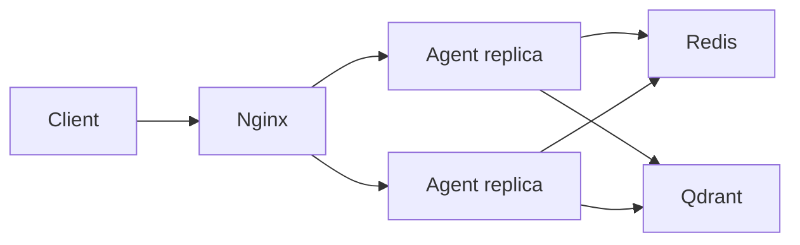

# Day 14 Lab — Mission Answers

> Bài làm được AI hỗ trợ. Các kết quả đo bên dưới lấy từ lệnh đã chạy trong môi trường hiện tại. Những phần cần Docker hoặc tài khoản cloud được ghi rõ là chưa chạy, không điền số giả.

## Part 1: Localhost vs Production

### Exercise 1.1: Anti-patterns trong `01-localhost-vs-production/develop/app.py`

1. Hardcode credential trực tiếp trong mã nguồn (`develop/app.py` dòng 17–18: `OPENAI_API_KEY`, `DATABASE_URL`); ai đọc mã nguồn hoặc lịch sử Git đều lấy được bí mật. Bản `production/app.py` sửa bằng cách đọc cấu hình qua `config.settings` từ biến môi trường (dòng 24).
2. Bật `DEBUG = True` và cấu hình cứng (`develop/app.py` dòng 21–22) thay vì quản lý theo môi trường.
3. Dùng `print()` in câu hỏi, câu trả lời và cả `OPENAI_API_KEY` ra stdout (`develop/app.py` dòng 33–38), gây lộ bí mật và log không có cấu trúc. Bản `production/app.py` chuyển sang JSON logging và không ghi secret (dòng 28–32, 111–122).
4. Thiếu `/health` và `/ready`, khiến nền tảng không phân biệt được process chết với ứng dụng chưa sẵn sàng. Bản `production/app.py` bổ sung đầy đủ cả hai endpoint (dòng 135–161).
5. Chỉ bind `host="localhost"`, cố định `port=8000` và bật `reload=True` (`develop/app.py` dòng 49–53), không chạy được trong container/cloud. Bản `production/app.py` dùng `settings.host` (`0.0.0.0`), `settings.port` từ `PORT` và chỉ bật `reload` khi `settings.debug=True` (dòng 194–199).
6. Không có lifecycle cleanup / xử lý `SIGTERM` để hoàn tất request đang chạy khi tắt. Bản `production/app.py` bổ sung `lifespan` (dòng 40–67) và handler `SIGTERM` (dòng 180–189).

### Exercise 1.2: Chạy và kiểm thử bản `develop`

Vì cổng 8000 trên máy đang có dịch vụ khác chiếm dụng, chạy bản `01-localhost-vs-production/develop/app.py` trên cổng trống (18001) và gọi `GET /` cùng `POST /ask?question=Hello` (lưu ý bản develop nhận `question` qua query string):

```http
HTTP/1.1 200 OK
content-type: application/json

{"message":"Hello! Agent is running on my machine :)"}
```

```http
HTTP/1.1 200 OK
content-type: application/json

{"answer":"Agent đang hoạt động tốt! (mock response) Hỏi thêm câu hỏi đi nhé."}
```

### Exercise 1.3: So sánh `develop` và `production`

| Tiêu chí | Develop (cơ bản) | Production (nâng cao) | Tại sao quan trọng? |
|---|---|---|---|
| Cấu hình & Secret | Hardcode trong source (`develop/app.py` dòng 17–22) | `config.py` đọc biến môi trường | Cùng một image chạy được ở dev/staging/prod; không commit secret vào Git. |
| Bind & Port | `localhost:8000` cố định | `0.0.0.0` và `PORT` từ env | Container/cloud cần lắng nghe mọi interface và dùng port do platform cấp. |
| Health check | Không có | `/health` (liveness) và `/ready` (readiness) | Liveness giúp platform restart khi crash; readiness kiểm soát việc route traffic. |
| Logging | `print()`, in cả API key ra stdout | Structured JSON logging, không log secret | Dễ lọc/tìm trên log aggregator và tránh rò rỉ bí mật. |
| Shutdown | Tắt đột ngột, không cleanup | FastAPI `lifespan` + xử lý `SIGTERM` | Hoàn tất request đang xử lý trước khi thoát, không cắt ngang người dùng khi deploy. |
| Auto-reload | Luôn bật (`reload=True`) | Chỉ bật khi `DEBUG=true` | `reload` gây tốn tài nguyên và không ổn định trên production. |

## Part 2: Docker

### Exercise 2.1: Dockerfile cơ bản

1. Base image: `python:3.11`.
2. Working directory: `/app`.
3. Copy `requirements.txt` và cài dependencies trước khi copy source để Docker tái sử dụng dependency layer khi chỉ đổi code.
4. `CMD` cung cấp lệnh mặc định có thể thay khi chạy container; `ENTRYPOINT` cố định executable chính, còn `CMD` thường cấp default arguments cho executable đó.

### Exercise 2.2–2.3: Build và image size

Docker image size và container test **chưa đo được**: môi trường này không có Docker CLI/daemon. Không điền số ước lượng. Lệnh đo khi có Docker:

```bash
docker build -f 02-docker/develop/Dockerfile -t my-agent:develop .
docker build -f 02-docker/production/Dockerfile -t my-agent:advanced .
docker images my-agent
```

Dockerfile advanced có builder stage cài/build dependencies và runtime stage dùng `python:3.11-slim`, chỉ copy packages và source cần để chạy. Tool/build dependencies không được đưa vào image cuối, giúp image gọn hơn và giảm bề mặt tấn công.

### Exercise 2.4: Compose architecture



Compose khởi động agent, Redis, Qdrant và Nginx trên network nội bộ. Nginx nhận traffic ở cổng 80 và phân phối tới agent; Redis lưu cache/session/rate-limit state, Qdrant phục vụ vector retrieval. Không chạy được stack/test Nginx trong môi trường này vì thiếu Docker.

## Part 3: Cloud Deployment

Chưa tạo deployment hoặc URL public vì môi trường hiện tại không có Railway/Render CLI hay phiên đăng nhập cloud. Không khai báo URL giả. Part 6 đã có cấu hình Railway tại `06-lab-complete/railway.toml` và Render tại `06-lab-complete/render.yaml`; Render Blueprint khai báo thêm Key Value cho Redis và truyền connection string qua environment.

**So sánh config:** `railway.toml` cấu hình builder Dockerfile, healthcheck và restart policy cho một service. `render.yaml` mô tả web service, environment variables và Redis Key Value trong Blueprint. Cả hai giữ API key trong cấu hình nền tảng thay vì source code.

Tham khảo định dạng chính thức: [Render Blueprint YAML](https://render.com/docs/blueprint-spec) và [Railway config-as-code](https://docs.railway.com/config-as-code/reference).

Lưu ý triển khai hiện tại: Railway đánh dấu `railway.toml` là Config as Code cũ; service mới không dùng được file này và hệ thống ngừng đọc file cũ từ 2026-12-01. File vẫn được giữ theo rubric lớp. Với repo mới, dùng Render Blueprint đã khai báo hoặc cấu hình Railway qua dashboard/IaC mới.

**Exercise 3.3 — Cloud Run pipeline:** Cloud Build chạy `pytest`, sau đó build Docker image có tag commit SHA và `latest`. Khi test thành công, pipeline push image lên Container Registry rồi deploy tag theo commit lên Cloud Run tại `asia-southeast1`. `service.yaml` khai báo ingress, concurrency/autoscaling, tài nguyên, environment variables lấy từ Secret Manager và health probes. Không cần deploy để mô tả pipeline.

## Part 4: API Security

### Exercise 4.1: Xác thực API Key (`04-api-gateway/develop`)

Khởi chạy với `AGENT_API_KEY=secret-key-123` và kiểm thử bằng `curl -i`:

1. **Không gửi `X-API-Key` → HTTP 401:**

```http
HTTP/1.1 401 Unauthorized
content-type: application/json

{"detail":"Missing API key. Include header: X-API-Key: <your-key>"}
```

2. **Có `X-API-Key: secret-key-123` → HTTP 200:**

```http
HTTP/1.1 200 OK
content-type: application/json

{"question":"Hello","answer":"Tôi là AI agent được deploy lên cloud. Câu hỏi của bạn đã được nhận."}
```

### Exercise 4.2–4.3: Kiểm tra JWT và Rate Limit (`04-api-gateway/production`)

Trong bản nâng cao, `POST /auth/token` xác thực user (`student` / `demo123`) rồi ký JWT HS256. `verify_token` kiểm tra chữ ký và thời hạn token, sau đó trả username/role cho route. Thiếu token trả 401; token sai/hết hạn trả 403/401. Khi xoay vòng (rotate) khóa bí mật ký token, token cũ không còn hợp lệ và client phải đăng nhập lại.

Rate limiter dùng **sliding window** theo user: tài khoản thường (`student`) giới hạn **10 request / 60 giây**, còn `admin` là 100 request / 60 giây. Khi vượt quota, API trả `429 Too Many Requests` kèm header `Retry-After`.

Kết quả chạy `curl -i` thực tế (token JWT đã được che thành `<REDACTED_JWT>`):

1. **Không gửi `Authorization` header → HTTP 401:**

```http
HTTP/1.1 401 Unauthorized
www-authenticate: Bearer
content-type: application/json
x-content-type-options: nosniff
x-frame-options: DENY

{"detail":"Authentication required. Include: Authorization: Bearer <token>"}
```

2. **Có `Authorization: Bearer <REDACTED_JWT>` (request #1) → HTTP 200:**

```http
HTTP/1.1 200 OK
content-type: application/json
x-content-type-options: nosniff
x-frame-options: DENY

{"question":"What is Docker?","answer":"Container là cách đóng gói app để chạy ở mọi nơi. Build once, run anywhere!","usage":{"requests_remaining":9,"budget_remaining_usd":1.9e-05}}
```

3. **Vòng lặp gửi liên tiếp request #2 → #12 (vượt ngưỡng 10 req/phút từ request #11 → HTTP 429):**

```text
Request #2  -> HTTP 200
Request #3  -> HTTP 200
Request #4  -> HTTP 200
Request #5  -> HTTP 200
Request #6  -> HTTP 200
Request #7  -> HTTP 200
Request #8  -> HTTP 200
Request #9  -> HTTP 200
Request #10 -> HTTP 200
Request #11 -> HTTP 429
Request #12 -> HTTP 429
```

Chi tiết `curl -i` của request #11:

```http
HTTP/1.1 429 Too Many Requests
x-ratelimit-limit: 10
x-ratelimit-remaining: 0
x-ratelimit-reset: 1795602268
retry-after: 59
content-type: application/json
x-content-type-options: nosniff
x-frame-options: DENY

{"detail":{"error":"Rate limit exceeded","limit":10,"window_seconds":60,"retry_after_seconds":59}}
```

**Vì sao cần cả Rate Limit và Cost Guard:** Rate limit kiểm soát *tốc độ gọi* (số request/phút) để chống spam/DDoS, còn Cost Guard kiểm soát *chi phí tiền thật* (USD theo lượng token input/output) để tránh hóa đơn LLM tăng vọt ngay cả khi số request nằm dưới ngưỡng rate limit.

### Exercise 4.4: Cost guard

Cost guard ước lượng input/output tokens, nhân với giá tương ứng, cộng usage theo user và theo tổng dịch vụ, rồi từ chối request khi budget ngày vượt ngưỡng. Bản demo Part 4 giữ state trong RAM, phù hợp để minh hoạ nhưng không chia sẻ được giữa nhiều worker/restart. Bản Part 6 đã lưu rate-limit và tổng chi phí theo ngày UTC vào Redis; giá token và ngân sách lấy từ cấu hình.

## Part 5: Scaling & Reliability

`/health` là liveness: trả 200 khi process còn chạy. `/ready` là readiness: kiểm tra dependency như Redis và trả 503 khi instance chưa nên nhận traffic. Graceful shutdown để server ngừng nhận request mới, hoàn tất request đang xử lý và đóng tài nguyên.

Conversation history không nên nằm trong dictionary trong RAM vì mỗi replica có memory riêng. Lưu history trong Redis giúp request kế tiếp đọc được dữ liệu dù load balancer gửi sang replica khác. Nginx phân phối request tới agent replicas; khi một replica lỗi, health-aware routing có thể chuyển traffic sang replica còn khoẻ.

`test_stateless.py` và stack 3 replicas chưa chạy được vì thiếu Docker. Theo hướng dẫn K5, stack cần `docker compose -p k5-day14-scaling up -d --build --scale agent=3`, `python test_stateless.py`, rồi `docker compose -p k5-day14-scaling down`.

## Part 6: Final Project

Đã hoàn thiện skeleton trong `06-lab-complete/`: environment config, API key 401, Redis sliding-window limiter với `Retry-After`, cost guard trả 402, `/health` và `/ready`, JSON logs, FastAPI lifespan shutdown, multi-stage Dockerfile, Compose agent+Redis, `.dockerignore`, Railway/Render config.

`python check_production_ready.py --static-only` xác nhận toàn bộ 28 kiểm tra tĩnh. `REDIS_URL=redis://localhost:6379/0 python check_production_ready.py --skip-docker` cho kết quả **10/12 tiêu chí, 39/39 kiểm tra thực hiện được đều passed**. Hai tiêu chí còn ⚠️ là Docker build/image/container và `docker stop`, vì Docker không có trong môi trường. Đây chưa phải `PASS 12/12`; cần chạy checker đầy đủ trên máy có Docker trước khi nộp.

Checklist output của lần chạy `--skip-docker`:

```text
📋 Checklist Deliverable
⚠️ Dockerfile (multi-stage, < 500 MB)
✅ docker-compose.yml (agent + redis)
✅ .dockerignore
✅ Health check endpoint (GET /health)
✅ Readiness endpoint (GET /ready)
✅ API Key authentication
✅ Rate limiting
✅ Cost guard
✅ Config từ environment variables
✅ Structured logging
⚠️ Graceful shutdown
✅ Public URL ready (Railway / Render config)
Result: 10/12 tiêu chí đạt · 39/39 checks passed
```

## Part 7: Benchmark & Observability

Đã tạo JSON eval/load reports trong `reports/`. Kết quả và các phần chưa thể chạy được ghi trong [BENCHMARK_REPORT.md](BENCHMARK_REPORT.md). v2 ban đầu đạt 21/23; sau khi bổ sung hai tài liệu cho JWT/API key và Kubernetes HPA, quality gate đạt 23/23 không regression. Grafana/Jaeger/Prometheus/Locust cần Docker nên chưa có screenshots hoặc CSV.

Quality gate cho CI nên chạy `python eval/run_eval.py --url http://localhost:8002 --min-accuracy 1.0 --baseline reports/eval_v2.json`; exit code 1 sẽ làm job thất bại và chặn merge.

## AI log

- Yêu cầu AI hoàn thiện các TODO của Part 6 theo hợp đồng trong `06-lab-complete/README.md`, chuẩn bị cấu hình deploy và rà soát các hạng mục còn thiếu theo `CHECKPOINTS.md` / `RUBRIC.md`.
- AI hỗ trợ viết code config, auth, Redis rate limiter/cost guard, health/readiness, JSON logging, Docker/Compose, Railway/Render, đồng bộ 2 mục knowledge base cho Exercise 7.3 và chuẩn hóa các báo cáo (`MISSION_ANSWERS.md`, `DEPLOYMENT.md`, `BENCHMARK_REPORT.md`) bằng tiếng Việt.
- Đã tự kiểm tra bằng cách chạy thực tế các lệnh local: Exercise 1.2, Exercise 4.1–4.3 (`curl -i` 401/200/429), eval v1/v2/fixed, load test 300 request và checker `--static-only` / `--skip-docker`. Các bước cần Docker và tài khoản cloud sẽ được chạy trên host terminal có Docker và cập nhật số liệu/ảnh thật trước khi nộp. Người nộp chịu trách nhiệm đọc, hiểu và giải thích toàn bộ mã nguồn cùng số liệu báo cáo.
